<div align="center">


<br/>

# 🎬 Edumix Stream Downloader Bot (v4)

**Next-generation Telegram bot for downloading, decrypting (Widevine/CENC DRM via Bento4), muxing, and uploading MPEG-DASH (MPD) streams directly to Telegram with real-time progress.**

[](https://www.python.org/)
[](https://github.com/Mayuri-Chan/pyrofork)
[](https://github.com/yt-dlp/yt-dlp)
[](https://www.bok.net/Bento4/)
[](https://ffmpeg.org/)
[](#-license)

<br/>

[✨ Features](#-key-features) • [⚡ Quick Deploy](#-quick-vps-deployment) • [⚙️ Configuration](#-configuration) • [🤖 Bot Commands](#-bot-commands) • [🔧 Service Management](#-systemd-service-management)

</div>

---

## ⚡ At a Glance

| Capability | Specification |
| :--- | :--- |
| **Stream Ingestion** | MPEG-DASH (`.mpd`) manifests parsed from raw URLs or full `yt-dlp` commands |
| **Media Extraction** | Concurrent video (`.mp4`) and audio (`.m4a`) download via `yt-dlp` |
| **DRM Decryption** | Widevine / CENC decryption via Bento4 `mp4decrypt` with multi-key support (`KID:KEY` hex/base64) |
| **Muxing & FastStart** | Zero-re-encode audio/video merge with streaming optimization (`-movflags +faststart`) |
| **Visual Metadata** | Automated 1920×1080 thumbnail generation + duration extraction via `ffprobe` |
| **Upload Pipeline** | Real-time dynamic progress bar, transfer rate, ETA, and native streaming support |
| **Access Control** | Dual-tier role-based access (Admins & Authorized users) with live `/auth` management |
| **Cleanup** | Automated atomic workspace wipe after upload completion or cancellation |

---

## 🎯 Processing Pipeline

```mermaid
flowchart LR
    A["User sends /download"] --> B["Paste yt-dlp cmd or MPD URL"]
    B --> C["Parse Manifest & Extract Tracks"]
    C --> D{"Multiple Qualities?"}
    D -- Yes --> E["Inline Quality Selector"]
    D -- No --> F["Auto-Select"]
    E --> G["Input Decryption Key(s) or /skip"]
    F --> G
    G --> H["Enter Video Name"]
    H --> I["Concurrent Download (yt-dlp)"]
    I --> J{"DRM Protected?"}
    J -- Yes --> K["Bento4 mp4decrypt"]
    J -- No --> L["Bypass Decryption"]
    K --> M["Lossless Mux (FFmpeg FastStart)"]
    L --> M
    M --> N["Generate 1080p Thumb & Duration"]
    N --> O["Stream Upload to Telegram"]
    O --> P["Auto-Purge Temp Files"]
```



---

## ✨ Key Features

- **Guided 4-Step Interactive Wizard**: Straightforward prompts guide you through link ingestion, quality selection, decryption credentials, and final naming.
- **Dynamic Inline Quality Keyboard**: Automatically presents available video resolutions (1080p, 720p, 480p, 360p) with bitrates fetched directly from the manifest `<BaseURL>`.
- **Bento4 CENC Decryption Engine**: Handles single or multiple keys in `KID:KEY` (32 hex characters or 16-byte Base64) or `KEY`-only format. Easily bypassed with `/skip` or `none` for unencrypted streams.
- **High-Efficiency Concurrent Streams**: Video and audio are fetched simultaneously, minimizing network latency and total download time.
- **Lossless Stream Copying**: Merges audio and video streams without CPU-intensive transcoding, preparing web-optimized MP4 files instantly.
- **Live Upload Meter**: Dynamic Telegram message edits showing transfer percentage, uploaded vs. total size, speed, and time remaining.
- **Strict Role-Based Access Control**: Unauthorized interactions are instantly blocked with their Telegram user ID displayed for easy admin whitelisting.

---

## 🚀 Quick VPS Deployment

Deploy on any Ubuntu/Debian VPS with the automated `install.sh` script:

### 1. Clone & Run Setup
```bash
sudo -i
apt-get update && apt-get install -y git
git clone https://github.com/NimeshPiyathissa/EMDUYUMIZ-DL-FOR-TG-BOT.git
cd EMDUYUMIZ-DL-FOR-TG-BOT
chmod +x install.sh && ./install.sh
```

> [!NOTE]
> `install.sh` automatically installs system packages (`ffmpeg`, `curl`, `wget`, `unzip`), downloads and installs the Bento4 SDK binaries to `/usr/local/bin`, sets up a dedicated Python virtual environment, symlinks `yt-dlp`, copies configuration templates, and registers the `edumix` systemd service.

### 2. Configure Credentials
```bash
nano .env
```
Fill in your `API_ID`, `API_HASH`, `BOT_TOKEN`, and `ADMIN_ID`.

### 3. Start the Bot
```bash
systemctl start edumix
```

---

## ⚙️ Configuration

### `.env` Reference Table

| Variable | Required | Description | Example |
| :--- | :---: | :--- | :--- |
| `API_ID` | **Yes** | Telegram API ID from [my.telegram.org](https://my.telegram.org) | `1234567` |
| `API_HASH` | **Yes** | Telegram API Hash from [my.telegram.org](https://my.telegram.org) | `0123456789abcdef0123456789abcdef` |
| `BOT_TOKEN` | **Yes** | Telegram Bot Token from [@BotFather](https://t.me/BotFather) | `123456:ABC-DEF1234ghIkl-zyx57W2v1u123ew11` |
| `ADMIN_ID` / `ADMIN_IDS` | **Yes** | Telegram ID(s) of administrators (comma-separated for multiple) | `987654321,11223344` |
| `AUTH_USERS` | No | Initial comma-separated list of whitelisted user IDs | `555666777,888999000` |
| `YTDLP_PATH` | No | Path to `yt-dlp` executable (defaults to `yt-dlp`) | `/usr/local/bin/yt-dlp` |
| `MP4DECRYPT_PATH` | No | Path to `mp4decrypt` executable (defaults to `mp4decrypt`) | `/usr/local/bin/mp4decrypt` |
| `BROWSER_UA` | No | Custom User-Agent header for HTTP requests and manifests | `Mozilla/5.0 ... Chrome/124.0.0.0` |

<details>
<summary><b>🔍 How Authorization & <code>auth_users.json</code> Works</b></summary>

<br/>

The bot stores whitelisted user IDs dynamically in `auth_users.json`:
- When an admin executes `/auth <user_id>`, the bot updates memory and writes to `auth_users.json`.
- When an admin executes `/unauth <user_id>`, the ID is removed from memory and `auth_users.json`.
- On boot, the bot loads IDs from `ADMIN_ID`, `AUTH_USERS` (from `.env`), and `auth_users.json`.

```json
[
  123456789,
  987654321
]
```
</details>

---

## 🤖 Bot Commands

### User Commands
- `/start` or `/help` — Display welcome message, user authorization status, and workflow guide.
- `/download` — Launch the 4-step interactive download wizard.
- `/cancel` — Terminate active download wizard or processing state.

### Administrator Commands
- `/auth <user_id>` — Authorize one or more user IDs (or reply with `/auth` to any message).
- `/unauth <user_id>` — Revoke bot access for a specific user ID.
- `/authlist` or `/users` — List all administrators and currently authorized users.

<details>
<summary><b>📝 Step-by-Step Command Walkthrough</b></summary>

<br/>

1. **Step 1: Input yt-dlp Command or MPD URL**
   ```text
   yt-dlp --add-header "Referer: https://stream.example.com/" "https://stream.example.com/manifest.mpd"
   ```
2. **Step 2: Quality Selection**
   Choose your desired stream from the inline keyboard (e.g. `🎞 1080p • 4500 kbps`).
3. **Step 3: Decryption Key Input**
   - Encrypted streams: send `KID:KEY` (e.g. `e1a2b3c4d5e6f7a8b9c0d1e2f3a4b5c6:11223344556677889900aabbccddeeff`)
   - Unencrypted streams: reply with `/skip` or `none`.
4. **Step 4: File Naming**
   Send the desired name (e.g. `Physics_Chapter_01`). The bot handles sanitization, downloading, decryption, muxing, and uploading automatically.

</details>

---

## 🔧 Systemd Service Management

The bot runs as a background service managed by Linux `systemd`:

```bash
# Check service status
systemctl status edumix

# Start / Stop / Restart service
systemctl start edumix
systemctl stop edumix
systemctl restart edumix

# View live real-time logs
journalctl -u edumix -f
```

<details>
<summary><b>🛠 Troubleshooting & Common Questions</b></summary>

<br/>

#### 1. `missing required tool(s): mp4decrypt` or `yt-dlp`
Ensure the tools are installed in `/usr/local/bin` and the systemd unit has the proper environment path:
```bash
which mp4decrypt yt-dlp ffmpeg
```

#### 2. Telegram File Size Limits
Telegram bot API limits bot uploads to **2 GB**. The bot will automatically check file size before uploading and alert you if the final output exceeds 2 GB.

#### 3. Updating the Bot
To pull updates from Git and restart:
```bash
cd /root/EMDUYUMIZ-DL-FOR-TG-BOT
git pull origin main
./venv/bin/pip install -r requirements.txt --upgrade
systemctl restart edumix
```

</details>

---

## 🔒 Security & Privacy

- **Safe from Secret Leaks**: `.env` and `auth_users.json` are strictly excluded from version control in `.gitignore`.
- **Automatic Sanitation**: All intermediate decrypted streams and temporary segments are purged from disk once the upload is completed or aborted.
- **Admin Lockdown**: Unauthorized users cannot trigger downloads, consume bandwidth, or inspect streams.

---

## 📄 License

This repository is maintained for educational and personal use. Review third-party licenses for [yt-dlp](https://github.com/yt-dlp/yt-dlp), [Pyrofork](https://github.com/Mayuri-Chan/pyrofork), [Bento4](https://www.bok.net/Bento4/), and [FFmpeg](https://ffmpeg.org/).
